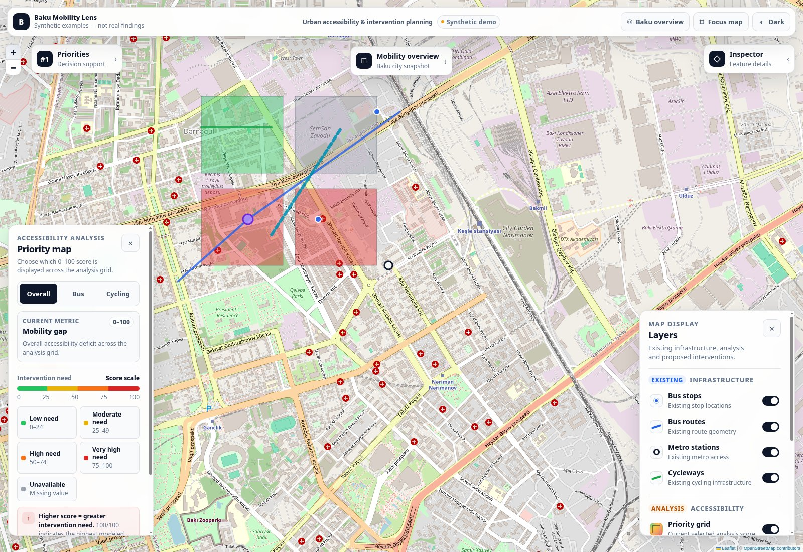
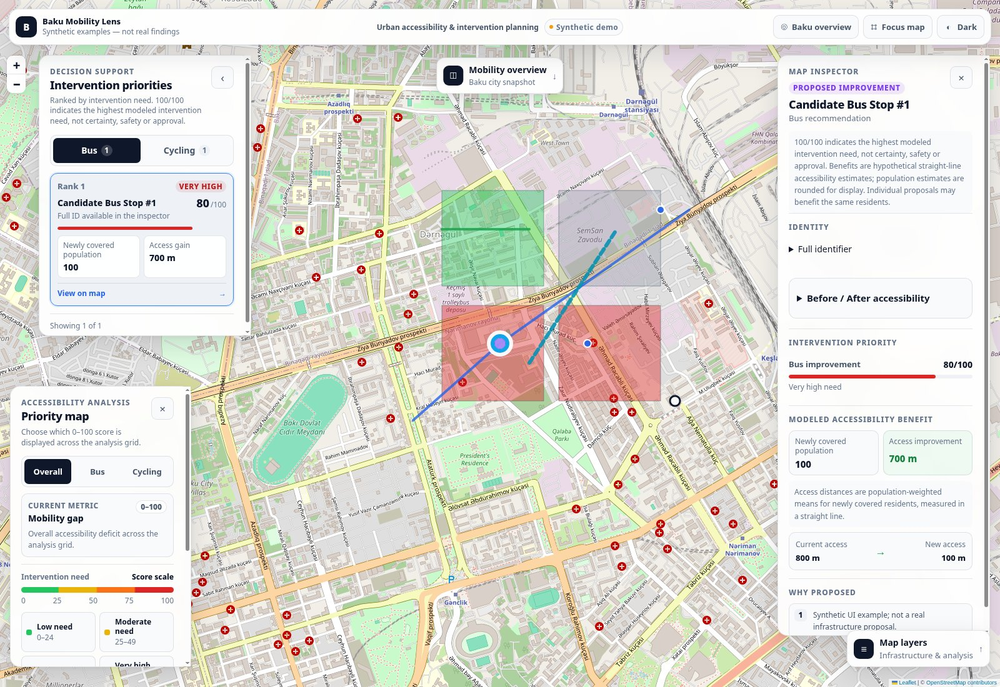
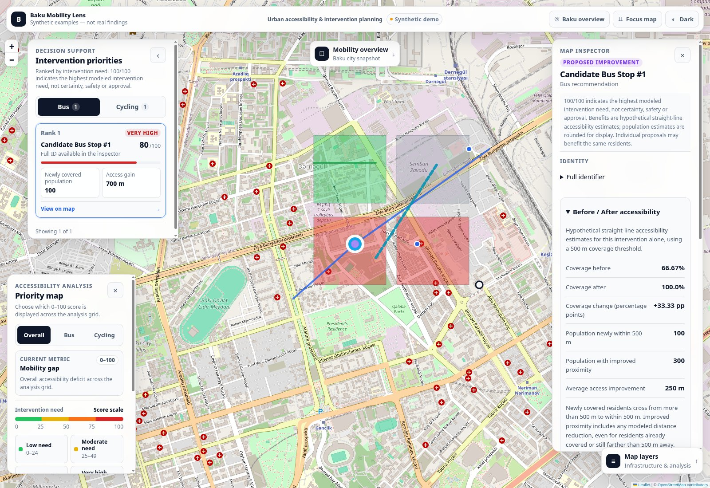
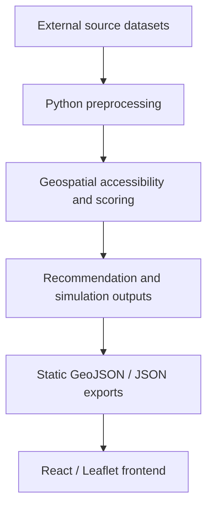
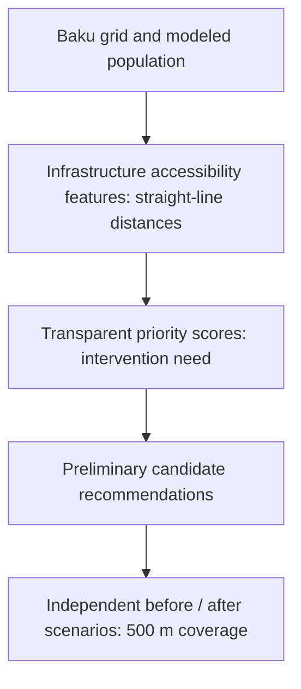

# Baku Mobility Lens

Baku Mobility Lens is an exploratory mobility accessibility project for Baku,
Azerbaijan. A Python geospatial pipeline combines mapped infrastructure, modeled
population and selected destinations to identify areas of unmet accessibility
need. A React/Leaflet interface lets users inspect those areas, review preliminary
bus-stop and bicycle-corridor candidates, and compare individual hypothetical
before/after scenarios.

This is a research prototype, not an operational transport planning service.
Accessibility is measured with **straight-line distances**, not walking routes or
journey times. Candidates have not passed field, engineering, legal-access or
safety assessments. Priority measures modeled intervention need, not certainty.



*Synthetic demo — invented vector features and illustrative values, not real
findings. Background map © OpenStreetMap contributors.*

## Implemented functionality

- Population-aware bus, bicycle and overall mobility-gap scores on a 250 m grid.
- Bus-stop candidates projected onto supplied route geometry, with spacing and
  independently checked population-coverage criteria.
- Bicycle corridor candidates following eligible, directed OSM graph edges;
  existing infrastructure is excluded from proposed new geometry.
- Deterministic, independently verified single-intervention accessibility scenarios.
- Interactive infrastructure layers, priority rankings, click-based feature
  inspection, full-ID details, keyboard controls and a paginated grid browser.
- Canvas grid rendering, metric changes without rebuilding grid geometry,
  responsive panels, light/dark themes and saved before/after comparisons.
- Validated static frontend exports and a ZIP integration package.

## Inspect candidates and compare accessibility



*Synthetic demo — click or select a ranked candidate to inspect its attributes.*



*Synthetic demo — the saved example distinguishes newly covered population from
everyone with improved proximity. These numbers are illustrative UI fixtures,
not calculated Baku results. Both screenshots retain OSM basemap attribution.*

[Capture details and reproduction steps](docs/images/README.md).

## Validated project statistics

The **local real-data snapshot**, checked on 2026-10-21, contains:

| Dataset | Features / records |
| --- | ---: |
| Analysis grid | 35,029 |
| Mapped bus stops | 1,414 |
| Supplied bus routes | 243 |
| Metro stations | 27 |
| Supplied cycleway features | 60 |
| Preliminary bus-stop candidates | 20 |
| Preliminary bicycle corridors | 14 |
| Individual scenarios | 34 (20 bus, 14 bicycle) |

These are snapshot counts, not counts in the synthetic demo or a guarantee of
complete infrastructure coverage. The real exports remain local while data
redistribution permissions are unresolved. See [release readiness](RELEASE_READINESS.md).

## Architecture



The frontend reads validated static files; it does not run Python or calculate
new scenarios in the browser. React 19, React-Leaflet 5, Leaflet 1.9.4 and Vite 8
provide the interface. GeoPandas, Shapely, PyProj, Rasterio, OSMnx and NetworkX
support the Python pipeline. See the [folder structure and Shared GeoJSON
Contract V1](docs/DEVELOPMENT.md#shared-geojson-contract-v1).

## Analysis workflow



Bicycle candidates follow eligible directed OSM paths. Accessibility benefits
still use straight-line proximity, not network travel times. Each scenario
compares one candidate with the same baseline; overlapping benefits must not be
summed into a citywide improvement. The diagrams describe the real pipeline;
the synthetic demo only illustrates its interface.

## Run the frontend from a clone

Use **Node 22.13+ within the Node 22 release line** (tested: 22.23.1, npm 10.9.8).
The locked Vite and ESLint versions impose Node engine requirements. Use the
committed lockfile; no additional mapping framework is required.

```bash
git clone https://github.com/baku-mobilitylens-team/baku-mobility-lens.git
cd baku-mobility-lens
# Until this work is merged, use the integration branch when available:
git switch integration/backend-and-scenarios
npm ci
npm run dev:demo
```

Open the local URL printed by Vite. **Synthetic demo** is visibly labeled in the
header. Its four cells, invented infrastructure, two candidates and two saved
scenario examples demonstrate the interface; none are real findings. All demo
coordinates and values were authored independently of source geometry. Saved
numbers are illustrative UI fixtures, not outputs of the spatial model.

```bash
npm test                 # Source-independent frontend unit/fixture checks
npm run lint
npm run build:demo       # Only synthetic assets; output: dist-demo/
npm run preview:demo
```

Demo mode uses `demo/public/`, ignores API configuration and never changes or
bundles the local real `public/data/`. `npm run demo:generate` reproduces only the
nine small fixtures in `demo/public/data/`. Background OSM tiles require internet
access; vector examples are local. See [demo details](demo/README.md).

`npm run dev` and `npm run build` retain the existing real/static-data workflow
and use `public/`. In a clone of the current tracked history this directory has
older mock fixtures (4 cells, 2 bus and 2 bicycle candidates) and no scenario
file. The app still renders available layers and reports saved scenarios as
unavailable; it does not invent results or substitute zero. Use the explicit demo
mode for a complete demonstration. **A normal local build may bundle rights-pending
real files: do not publish `dist/` without data clearance.**

No HTTP API server is shipped. `.env.example` defaults to static loading;
`VITE_API_BASE_URL` is only for a separately provided compatible API.

## Backend reproducibility

A clone can run the synthetic demo and source-independent tests. Reproducing the
complete Baku analysis additionally requires authorized source inputs, the
recorded source versions and a compatible geospatial Python environment.

```bash
cd backend
python3 -m venv .venv
. .venv/bin/activate
python -m pip install -r requirements.txt
PYTHONDONTWRITEBYTECODE=1 python -m unittest discover -s tests -v
```

Python 3.14.7 was used locally. The direct dependencies are pinned; a complete
transitive/native environment lock is not supplied. Read the [development guide](docs/DEVELOPMENT.md)
for source filenames, processing order, export/verification commands, environment
requirements and the unchanged Shared Contract V1. See also the
[data inventory](backend/DATA_INVENTORY.md), [frontend performance notes](FRONTEND_PERFORMANCE.md)
and [saved-scenario UI documentation](FRONTEND_SIMULATIONS.md).

## Data sources and limitations

The real analysis combines OpenStreetMap, WorldPop, geoBoundaries,
OpenData.az resources and AYNA-attributed transport geometries. These sources
have separate licensing and provenance requirements. **AYNA redistribution
rights remain unverified; attribution alone does not establish permission.**
Real inputs, derived exports and screenshots of those layers remain subject to
data-specific review. See the [source audit and exact publication blockers](backend/DATA_SOURCES.md#public-release-data-rights-audit--2026-10-21)
and [release report](RELEASE_READINESS.md).

### Methodologies and interpretation

- [Scoring methodology](backend/SCORING_METHODOLOGY.md): modeled need, with explicit
  uncalibrated planning weights; missing population retains null scores.
- [Bus methodology](backend/BUS_RECOMMENDATIONS_METHODOLOGY.md): straight-line
  coverage and route-proximity screening, not verified stop–route membership.
- [Bicycle methodology](backend/BIKE_RECOMMENDATIONS_METHODOLOGY.md): conservative
  tag eligibility and routing cost are not physical safety assessments. OSM
  bicycle-permissible roads are not necessarily bicycle lanes.
- [Simulation methodology](backend/SIMULATION_METHODOLOGY.md): baseline versus one
  intervention using a 500 m threshold. `population_improved` includes any modeled
  distance reduction; `newly_covered_population` counts threshold crossings.
  Coverage change is **percentage points**, using the same known-population
  denominator before and after. Separate scenario benefits may overlap and must
  never be added into a combined citywide gain.

The bicycle simulation baseline uses AYNA lanes only. Five bicycle recommendations
have additional existing-OSM coverage exclusions and therefore differ from their
saved simulation's newly covered population; the UI preserves their statuses and
limitations. Twenty bus and nine bicycle records match. The simulator's aggregate
reconciliation does not independently recheck the OSM exclusions.

WorldPop counts are modeled, with 15,917 unknown-population cells in this snapshot
and other partially covered cells. Unknown does not mean uninhabited. OSM and
supplied infrastructure can be incomplete or stale. Route/day validations are
not stop-level demand; metro entries are not origin–destination trips. Source
geometry does not demonstrate operating service, access permission, buildability
or safety. Performance measurements are local observations, not browser/device
service guarantees.

## Contributors

- [@osmanveyisli](https://github.com/osmanveyisli): backend, data engineering,
  geospatial analysis, scoring, recommendations, simulations and validation.
- [@ahaddilanov](https://github.com/ahaddilanov): frontend, React/Leaflet map,
  interface design, visualization and interaction engineering.

Integration and testing were collaborative. See [CONTRIBUTORS.md](CONTRIBUTORS.md).

## MIT code license

Both contributors explicitly approved releasing their original source code
under the [MIT License](LICENSE).

Copyright (c) 2026 osmanveyisli and ahaddilanov

The code license does **not** replace third-party dataset or dependency licenses.
OpenStreetMap, WorldPop, geoBoundaries, OpenData.az and AYNA-attributed data are
not relicensed under MIT. Screenshot basemaps retain OpenStreetMap attribution
and applicable terms; synthetic overlays do not remove those obligations.

## Future improvements

Obtain and document source redistribution rights; preserve reproducible authorized
snapshots and complete environment locks; validate missing population semantics
and POI categories; incorporate verified stop–route relationships and service
frequency; compare network-based walking accessibility; assess candidate crossings,
barriers, gradients and safety in the field. Joint intervention analysis would
need a new non-additive portfolio calculation. These are future work, not
capabilities claimed by this release.
